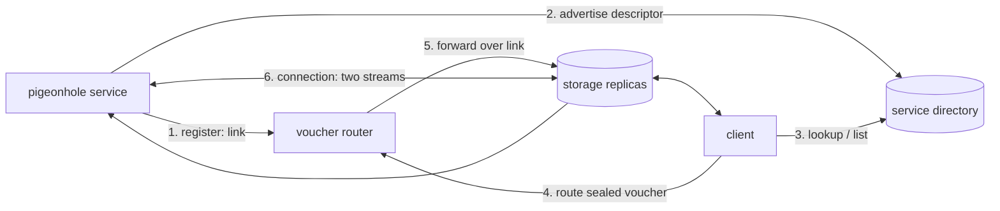

# Pigeonhole services

A pigeonhole service is a program on the Katzenpost mixnet that speaks only
Pigeonhole: it has no address and no open port, and everything it sends or
receives is a box written to or read from the storage replicas. ELIZA in this
repository is one. Two mixnet services, run as plugins on service nodes, let
clients find pigeonhole services and start talking to them:

- the **service directory** (capability `service_directory`) holds a
  descriptor for each service, saying how to reach it;
- the **voucher router** (capability `voucher_router`) relays a client's
  first message to a service.

A client finds a service in the directory, then *dials* it: it exchanges a
contact voucher with the service through a router. Afterwards the two hold a
connection made of two Pigeonhole streams, one written by each side, and each
holds the read capability of the other's stream. No router or directory is
involved from then on.



Every party reaches the mixnet through a client daemon, kpclientd. The daemon
does all the cryptography that involves keys: Sphinx, Pigeonhole's BACAP
streams, the contact voucher operations, NIKE key generation and shared
secrets, and sealed boxes.

## Identity

A service is known by its NIKE keypair, X25519 and CTIDH1024 combined as a
hybrid NIKE (`x25519-ctidh1024`). Its identity, the `ServiceID`, is the
BLAKE2b-256 hash of the public key, written as 64 hex digits. A service keeps
the keypair in its data directory as `name.private.pem` and
`name.public.pem`, so its identity survives restarts.

The router and the directory each have a NIKE keypair too, which they publish
in the PKI document as the parameters `nikeScheme` and `publicKey` of their
service node entry. A client trusts a router or a directory because the PKI
lists it; it trusts nothing a directory says without checking it against the
PKI.

## Connections

A connection is two Pigeonhole streams. Each side writes messages, one per
box, to the next box of its own stream, and reads the peer's stream box by
box, waiting for each one to be written. A message is at most one box;
larger content is the application's to split.

Storage replicas keep a box for one to two replica epochs. A connection
keeps every box it sent within its retention period (seven days by default)
and rewrites them all once a replica epoch, so a peer that is offline for
days still finds them. Rewrites are idempotent. A connection's state, its
caps, indices and retained boxes, is saved after every send and receive, so
it survives a restart of either side.

## The contact voucher handshake

Every connection starts with the contact voucher handshake. One side, the
*joiner*, mints a voucher; the other, the *inductor*, uses it. The voucher is
a short secret from which both derive a two-box *voucher stream*:

1. The joiner creates its message stream and mints a voucher for it. It
   writes the voucher payload to box 0 of the voucher stream.
2. The voucher reaches the inductor.
3. The inductor reads box 0, creates its own message stream, and writes a
   sealed reply to box 1. The reply holds a `WhoReply` naming the inductor
   and the read cap of its stream.
4. The inductor tombstones box 0, so the voucher cannot be used again.
5. The joiner reads box 1 and opens the reply.

Both sides now hold the read cap of the other's stream: the joiner got the
inductor's from the reply, and the inductor got the joiner's from the
payload. A voucher can be used once.

Who mints and who inducts depends on how the voucher travels:

| Path | Joiner | Inductor | How the voucher travels |
|---|---|---|---|
| Dial through a router | the client | the service | sealed to the service, through a router |
| Offer | the service | the client | out of band: a user pastes it into a chat app |
| Register with a router | the service | the router | in a `RegisterRequest` |

## Registering with routers

A service registers with every voucher router in the PKI. To register, it
mints a voucher, as the joiner, and sends the router a `RegisterRequest`
holding the voucher, its public key and a MAC. The router checks the MAC,
answers `StatusOK`, and inducts the voucher. The resulting connection is the
service's *link* with the router.

The router writes each sealed voucher addressed to the service to its own
stream of the link, as a `LinkMessage`. It keeps them rewritten for its
retention period (seven days by default), so a service that was offline
still receives them. A router bounds the vouchers one link retains (4096 by
default) and refuses routes beyond that with `StatusBusy`.

A service rescans the PKI every ten minutes and registers with any router it
has no link with. A link whose reader fails is forgotten, and registered
again on the next rescan.

## Advertising in the directory

Once a service holds a link, it advertises its `ServiceDescriptor` in every
directory in the PKI: its NIKE scheme, its public key, and the routers it
holds links with. It advertises when it starts and again each time it opens
a new link.

An `AdvertiseRequest` carries a sequence number and a MAC. The directory
accepts it only if the MAC verifies against the descriptor's own public key
and the sequence number is greater than that of the descriptor it replaces.
A service uses the current time in nanoseconds, or one more than its last
number if that is larger. A `WithdrawRequest` removes a descriptor; the
directory keeps the withdrawal's sequence number, so a delayed or replayed
older advertisement cannot bring the descriptor back.

## Discovery

A client asks a directory for one descriptor with a `LookupRequest`, and the
directory answers it in its reply.

For all descriptors, a `ListRequest` returns the read cap and start index of
a *snapshot stream*. The directory writes every descriptor it holds to a new
snapshot whenever one changes (gathering a burst of changes into one
snapshot) and at least once per refresh interval (a day by default). A
snapshot is a 4-byte big-endian length followed by the canonical CBOR of a
`Snapshot`, split across as many boxes as it needs.

A client asks every directory in the PKI. For a lookup it asks each in turn
until one knows the service, and checks that the descriptor it gets back is
that service's; for a list it merges the answers, taking the union of the
routers each directory reports for a service, so one directory cannot hide
the others' routers.

## Dialing a service

To dial a service, a client:

1. looks up the service's descriptor;
2. mints a voucher, as the joiner;
3. seals the voucher to the service's public key, as an anonymous sealed box;
4. sends a `RouteRequest` holding the `ServiceID` and the sealed voucher to
   one of the routers in the descriptor;
5. waits for the service's reply in box 1 of the voucher stream.

A client tries only routers the PKI lists, since a descriptor comes from an
untrusted directory, and gives each five minutes before trying the next.

The router looks up the link of the `ServiceID` and forwards the sealed
voucher over it, answering `StatusOK`, or `StatusUnknownService` if it has no
link with that service. It cannot open the voucher. The service opens it with
its private key and inducts it. A service remembers each voucher it opened
for an hour, so one forwarded twice is handled once, and gives each
handshake ten minutes.

The router learns which service a voucher is for, and when, but not which
client sent it: the client's request travels over Sphinx with a reply
SURB.

A chat app that cannot route vouchers itself can mint one, as the joiner, and
hand it to `pigeonhole-voucher send SERVICE_IDENTITY VOUCHER_TOKEN`, which
routes it to the service; the conversation then opens in the app.

## Offering a voucher

A service can also mint vouchers itself, as the joiner, for clients to
induct. It keeps each one, across restarts, until a client uses it. ELIZA
keeps three on offer in `data_dir/vouchers/`, each as the base64 text a
katzenqt user pastes into "Induct via voucher". This needs no router or
directory.

## Request authentication

`RegisterRequest`, `AdvertiseRequest` and `WithdrawRequest` carry a MAC that
proves the request comes from the holder of the service's private key,
without a challenge round:

```text
ss  = DH(servicePriv, pluginPub) = DH(pluginPriv, servicePub)
key = HKDF-BLAKE2b-256(ss, salt = none, info = "katzenpost-pigeonservice-mac-v1" || pluginPub || servicePub)
mac = BLAKE2b-256(key = key, msg = canonical CBOR of the request with MAC null)
```

`pluginPub` is the router's or the directory's public key from the PKI, and
`servicePub` the service's. A shared secret of all zeros is rejected. MACs
are compared in constant time.

## Wire format

Requests to the router and the directory are the payloads of Sphinx queries
to the plugin's endpoint; replies come back in the reply SURB. Every message
is canonical CBOR. A map's keys are the field names below; a field marked
`omitempty` is left out when empty. Sphinx payloads arrive padded, so a
decoder accepts trailing zero bytes after the item and rejects anything else.
The client daemon retransmits a request until a reply arrives, so the router
and the directory treat a repeated request as one.

### Constants

```go
const (
	RouterCapability    = "voucher_router"
	DirectoryCapability = "service_directory"

	// PKI parameters holding a plugin's NIKE public key.
	ParamNIKEScheme = "nikeScheme"
	ParamPublicKey  = "publicKey"
)

// Reply status codes.
const (
	StatusOK uint8 = iota
	StatusInvalidRequest
	StatusBadMAC
	StatusUnknownService
	StatusStale
	StatusBusy
	StatusInternalError
)
```

### Descriptors

```go
// ServiceID names a service: the BLAKE2b-256 hash of its public key.
type ServiceID [32]byte

// RouterRef names one voucher router: the service node it runs on and its
// endpoint there.
type RouterRef struct {
	NodeIDHash [32]byte
	Endpoint   string
}

// ServiceDescriptor is everything a client needs to reach a service.
type ServiceDescriptor struct {
	NIKEScheme string      // the scheme of PublicKey
	PublicKey  []byte      // the key a client seals its voucher to
	Routers    []RouterRef // routers holding a live link with the service; null when none
}
```

### Router messages

```go
// RouterRequest is the payload of a query to a voucher router. Exactly one
// field is set.
type RouterRequest struct {
	Route    *RouteRequest    `cbor:",omitempty"`
	Register *RegisterRequest `cbor:",omitempty"`
}

// RouteRequest asks a router to forward a sealed voucher to a service.
type RouteRequest struct {
	ServiceID  ServiceID
	Ciphertext []byte // the voucher, sealed to the service's public key
}

// RegisterRequest asks a router to open a link with a service. Voucher is
// one the service minted; the router inducts it.
type RegisterRequest struct {
	NIKEScheme string
	PublicKey  []byte
	Voucher    []byte
	MAC        []byte
}

// RouterReply answers a RouterRequest.
type RouterReply struct {
	Status uint8
}

// LinkMessage is one box on the router's stream of a link.
type LinkMessage struct {
	Forward []byte `cbor:",omitempty"` // a client's sealed voucher
}
```

### Directory messages

```go
// DirectoryRequest is the payload of a query to the service directory.
// Exactly one field is set.
type DirectoryRequest struct {
	Advertise *AdvertiseRequest `cbor:",omitempty"`
	Withdraw  *WithdrawRequest  `cbor:",omitempty"`
	Lookup    *LookupRequest    `cbor:",omitempty"`
	List      *ListRequest      `cbor:",omitempty"`
}

// AdvertiseRequest publishes or replaces a service's descriptor. Seq must
// exceed the Seq of the descriptor it replaces.
type AdvertiseRequest struct {
	Descriptor ServiceDescriptor
	Seq        uint64
	MAC        []byte
}

// WithdrawRequest removes a service's descriptor. Seq must exceed the Seq of
// the descriptor it removes.
type WithdrawRequest struct {
	ServiceID ServiceID
	Seq       uint64
	MAC       []byte
}

// LookupRequest asks for one service's descriptor.
type LookupRequest struct {
	ServiceID ServiceID
}

// ListRequest asks where the current snapshot of all descriptors is.
type ListRequest struct{}

// DirectoryReply answers a DirectoryRequest.
type DirectoryReply struct {
	Status     uint8
	Descriptor *ServiceDescriptor `cbor:",omitempty"` // answers a Lookup
	ReadCap    []byte             `cbor:",omitempty"` // the snapshot stream, answering a List
	StartIndex []byte             `cbor:",omitempty"`
}

// Snapshot is the content of a snapshot stream: every descriptor the
// directory holds.
type Snapshot struct {
	Seq         uint64
	Descriptors []ServiceDescriptor
}
```

### The WhoReply

The inductor's sealed reply holds a `WhoReply` in the shape of katzenqt's
group chat `ReplyWho`, with one member: the inductor.

```go
type whoReply struct {
	PleaseAdds []pleaseAdd `cbor:"please_adds"` // exactly one entry
}

type pleaseAdd struct {
	DisplayName string `cbor:"display_name"`
	ReadCap     []byte `cbor:"read_cap"` // the inductor's message stream
}
```

## Interfaces

### What a service needs from the mixnet

Both implementations of the framework reach the mixnet through one interface,
which the thin client provides. In katzenpost's `pigeonservice` package:

```go
type Pigeonhole interface {
	// Streams and boxes.
	NewStream() (*bacap.WriteCap, *bacap.ReadCap, *bacap.MessageBoxIndex, error)
	Write(ctx context.Context, writeCap *bacap.WriteCap, idx *bacap.MessageBoxIndex, plaintext []byte) (*bacap.MessageBoxIndex, error)
	Read(ctx context.Context, readCap *bacap.ReadCap, idx *bacap.MessageBoxIndex) ([]byte, *bacap.MessageBoxIndex, error)
	Tombstone(ctx context.Context, writeCap *bacap.WriteCap, idx *bacap.MessageBoxIndex) error
	WritePayload(ctx context.Context, writeCap *bacap.WriteCap, idx *bacap.MessageBoxIndex, payload []byte) (*bacap.MessageBoxIndex, error)
	MaxPlaintext() int

	// The contact voucher operations.
	VoucherMint(messageWriteCap []byte, displayName string) (*MintResult, error)
	VoucherInduct(voucher, payload, whoReply []byte) (*InductResult, error)
	VoucherOpen(secretKey, sealedReply, messageWriteCap []byte) (*OpenResult, error)
	VoucherDeriveStream(voucher []byte) (writeCap, readCap []byte, err error)

	// BoxSeal seals plaintext to a NIKE public key.
	BoxSeal(nikeScheme string, publicKey, plaintext []byte) ([]byte, error)

	// Mixnet services: a query with a reply, and the instances the PKI lists.
	Request(ctx context.Context, node *[32]byte, endpoint []byte, payload []byte) ([]byte, error)
	Services(capability string) ([]ServiceNode, error)
}
```

In this crate it is the transport's `Backend` trait, which also carries the
NIKE operations the daemon does for a service:

```rust
pub trait Backend: Send + Sync + 'static {
    fn new_keypair(&self) -> impl Future<Output = Result<Keypair>> + Send;
    fn write_box(&self, write_cap: &[u8], index: &[u8], plaintext: &[u8]) -> impl Future<Output = Result<()>> + Send;
    fn read_box(&self, read_cap: &[u8], index: &[u8]) -> impl Future<Output = Result<Read>> + Send;
    fn replica_epoch(&self) -> impl Future<Output = Result<u64>> + Send;
    fn max_plaintext(&self) -> impl Future<Output = Result<usize>> + Send;

    fn voucher_mint(&self, write_cap: &[u8], name: &str) -> impl Future<Output = Result<Minted>> + Send;
    fn voucher_derive_stream(&self, voucher: &[u8]) -> impl Future<Output = Result<(Secret, Secret)>> + Send;
    fn voucher_induct(&self, voucher: &[u8], payload: &[u8], who_reply: &[u8]) -> impl Future<Output = Result<Inducted>> + Send;
    fn voucher_open(&self, secret_key: &[u8], sealed_reply: &[u8], write_cap: &[u8]) -> impl Future<Output = Result<Opened>> + Send;

    fn request(&self, node: &[u8; 32], endpoint: &[u8], payload: &[u8]) -> impl Future<Output = Result<Vec<u8>>> + Send;
    fn services(&self, capability: &str) -> impl Future<Output = Result<Vec<ServiceNode>>> + Send;

    fn nike_generate_key_pair(&self, scheme: &str) -> impl Future<Output = Result<(Vec<u8>, Secret)>> + Send;
    fn nike_derive_secret(&self, scheme: &str, private: &[u8], public: &[u8]) -> impl Future<Output = Result<Secret>> + Send;
    fn box_seal(&self, scheme: &str, public: &[u8], plaintext: &[u8]) -> impl Future<Output = Result<Vec<u8>>> + Send;
    fn box_open(&self, scheme: &str, private: &[u8], ciphertext: &[u8]) -> impl Future<Output = Result<Vec<u8>>> + Send;
}
```

`ThinClientBackend::dial(daemon)` provides it over kpclientd, where `daemon`
is `@name` for an abstract unix socket, a socket path, or `host:port`.

### Writing a service

A service is a `Service` and a handler run for each client's session
(`src/services/service.rs`):

```rust
impl<B: Backend> Service<B> {
    pub fn new(cfg: Config, ph: Arc<B>) -> Result<Self, Error>;
    pub fn id(&self) -> ServiceId;
    pub fn descriptor(&self) -> ServiceDescriptor;
    /// Resumes links, registers with every router in the PKI, advertises.
    pub fn listen(&self) -> Result<(), Error>;
    /// The next client's arrival; `Incoming::handshake` completes it.
    pub async fn accept(&self) -> Result<Incoming<B>, Error>;
    /// Listens and serves each session with `handler`, bounded by
    /// `max_concurrent_sessions`; a session ends when its handler returns.
    pub async fn run<F, Fut>(&self, handler: F) -> Result<(), Error>
    where F: Fn(Session<B>) -> Fut + Send + Sync + 'static, Fut: Future<Output = ()> + Send + 'static;
    /// Mints a voucher for a client to induct.
    pub async fn offer(&self) -> Result<Vec<u8>, Error>;
    pub fn offers(&self) -> Vec<Vec<u8>>;
    /// Stops; sessions are kept for the next start.
    pub async fn close(&self);
}
```

`Config::new(key, data_dir)` gives the defaults: a display name, advertising
on, 64 concurrent sessions, seven days' retention, a ten-minute handshake
timeout and a ten-minute PKI rescan. A `Session` derefs to its `Conn`; it
reports whether it was `restored()` from disk.

A connection, on either side:

```rust
impl<B: Backend> Conn<B> {
    pub async fn max_message(&self) -> Result<usize, Error>;
    pub async fn send(&self, msg: &[u8]) -> Result<(), Error>;
    pub async fn recv(&self) -> Result<Vec<u8>, Error>;
    pub async fn refresh(&self, retention: Duration) -> Result<(), Error>;
    pub fn state(&self) -> ConnState;
    pub fn restore(ph: Arc<B>, s: &ConnState, poll: Duration) -> Self;
}
```

The Go framework has the same shape: `NewService(Config, Pigeonhole)`,
`Service.Run(ctx, Handler)` with

```go
type Handler interface {
	OnSession(ctx context.Context, s *Session)
}
```

and `Session` embedding `*Conn`, whose methods are `Send`, `Recv` and
`Refresh`.

### Reaching a service

```rust
/// Mints a voucher, routes it to the service and waits for its reply.
pub async fn dial<B: Backend>(ph: Arc<B>, d: &ServiceDescriptor, display_name: &str, poll: Duration) -> Result<Conn<B>, Error>;
/// Seals a voucher to the service and hands it to one of its routers.
pub async fn route<B: Backend>(ph: &B, d: &ServiceDescriptor, voucher: &[u8]) -> Result<(), Error>;
/// Inducts a voucher a service offered.
pub async fn induct<B: Backend>(ph: Arc<B>, voucher: &[u8], display_name: &str, poll: Duration) -> Result<Conn<B>, Error>;
```

A client speaks to directories through `Directory`; `Directory::all` returns
one per directory in the PKI. Advertising and withdrawing take the service's
own key; looking up and listing take none.

```rust
impl<B: Backend> Directory<B> {
    pub async fn all(ph: Arc<B>, key: Option<Keypair>, poll: Duration) -> Result<Vec<Self>, Error>;
    pub async fn advertise(&self, d: &ServiceDescriptor) -> Result<(), Error>;
    pub async fn withdraw(&self, id: ServiceId) -> Result<(), Error>;
    pub async fn lookup(&self, id: ServiceId) -> Result<ServiceDescriptor, Error>;
    pub async fn list(&self) -> Result<Vec<ServiceDescriptor>, Error>;
}
```

In Go the same roles are two interfaces, which the `directory` package's
`All` implements over every directory in the PKI:

```go
type Advertiser interface {
	Advertise(ctx context.Context, d *ServiceDescriptor) error
	Withdraw(ctx context.Context, id ServiceID) error
}

type Discoverer interface {
	Lookup(ctx context.Context, id ServiceID) (*ServiceDescriptor, error)
	List(ctx context.Context) ([]ServiceDescriptor, error)
}
```

## Programs

| Program | Where | What it does |
|---|---|---|
| `voucher-router` | katzenpost `cmd/voucher-router` | the voucher router plugin |
| `service-directory` | katzenpost `cmd/service-directory` | the service directory plugin |
| `pigeonhole-voucher` | katzenpost `cmd/pigeonhole-voucher` | `list` the directory's services; `send` a service a voucher a chat app minted |
| `pigeonhole-echo` | katzenpost `cmd/pigeonhole-echo` | a service that sends back each message |
| `eliza` | `src/bin/eliza.rs` | ELIZA, speaking katzenqt's chat framing |

The two plugins run on a service node beside the courier. Each takes a
`data_dir` for its key and database, and a `thin_config` naming the
kpclientd it reaches the mixnet through, since a router and a directory read
and write Pigeonhole streams like any service:

```toml
[[ServiceNode.CBORPluginKaetzchen]]
  Capability = "voucher_router"
  Endpoint = "voucher_router"
  Command = "/usr/local/bin/voucher-router"
  MaxConcurrency = 1
  [ServiceNode.CBORPluginKaetzchen.Config]
    data_dir = "/var/lib/katzenpost-servicenode/voucher_router"
    log_dir = "/var/log/katzenpost/voucher_router"
    thin_config = "/etc/katzenpost-servicenode/pigeonservice-thinclient.toml"

[[ServiceNode.CBORPluginKaetzchen]]
  Capability = "service_directory"
  Endpoint = "service_directory"
  Command = "/usr/local/bin/service-directory"
  MaxConcurrency = 1
  [ServiceNode.CBORPluginKaetzchen.Config]
    data_dir = "/var/lib/katzenpost-servicenode/service_directory"
    log_dir = "/var/log/katzenpost/service_directory"
    thin_config = "/etc/katzenpost-servicenode/pigeonservice-thinclient.toml"
```

A plugin generates its keypair on first start and publishes the public key
in the PKI through the server.
